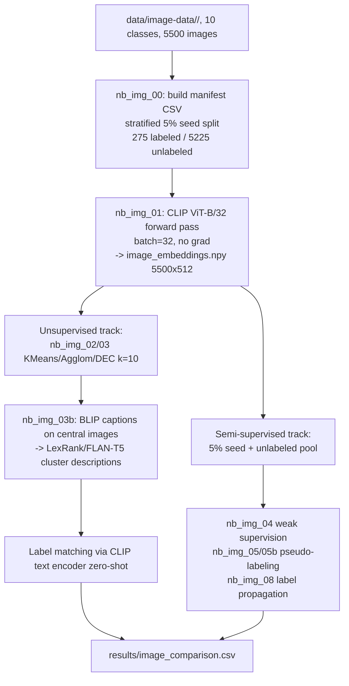
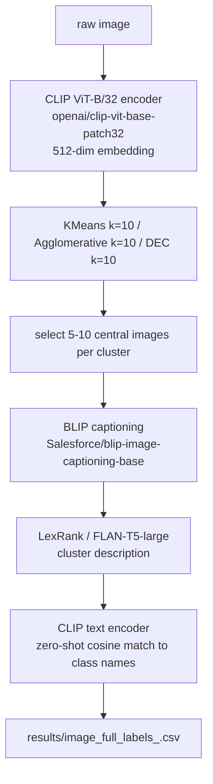
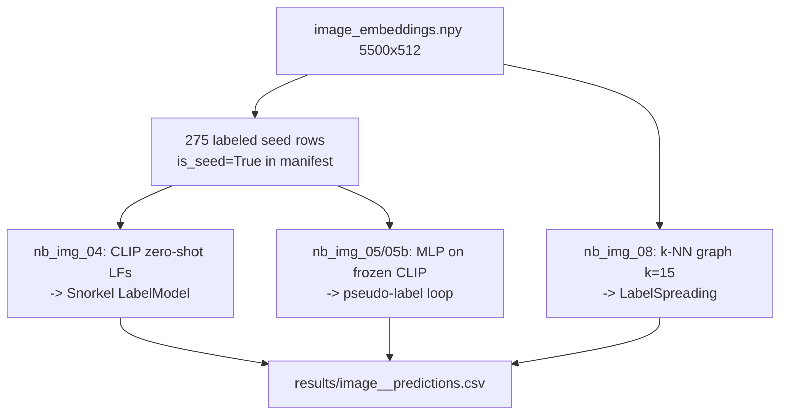

# Auto-Labeling for Image Classification — Animal Dataset (10 Classes)

**Project summary for presentation**
Date: 2026-09-24 (pipeline design approved; implementation pending)

> This document describes the image-track pipeline, a parallel project to the
> text-track pipeline documented in [`PROJECT_SUMMARY.md`](PROJECT_SUMMARY.md).
> Both tracks apply the same auto-labeling framework (unsupervised clustering,
> weak supervision, label propagation, pseudo-labeling) but the image track
> adds a description-generation phase before label matching.

## 1. Goal

Automatically assign category labels to a dataset of animal images
**without full human annotation**, and compare how far unsupervised
clustering, weak supervision, label propagation, and pseudo-labeling each
get toward that goal — using **10 animal classes** with ground-truth labels
derived from folder names.

The image pipeline extends the text pipeline in one key way: raw images
cannot be inspected as text, so an intermediate **description generation**
step converts visual content into natural language before label matching.
This mirrors the text pipeline's summarization step (`facebook/bart-large-cnn`
generating summaries before embedding), but uses a vision-language model instead.

## 2. Dataset

`data/image-data/<class>/` — 5,500 images (550/class), JPEG format.

**10 classes** (folder names, used as ground-truth labels):

butterfly, cat, chicken, cow, dog, elephant, horse, sheep, spider, squirrel

All images are pre-organized into class folders — no external manifest or
annotation file needed. Ground-truth labels are derived directly from folder
names.

**Split design (semi-supervised setting):**

- **Stratified 5% seed** — ~27–28 images/class = **275 labeled images** total.
  These are the only images treated as "labeled" during semi-supervised training.
- **Remaining 95%** — ~5,225 images treated as unlabeled.
- Fixed `random_state=42` for reproducibility.
- `is_seed` column in `data/image_manifest.csv` flags labeled rows.

## 3. Pipeline / Data Flow

### 3.1 Overall pipeline



### 3.2 Embedding → cluster → describe flow (unsupervised)



### 3.3 Semi-supervised data flow



## 4. Approaches

### 4.1 Unsupervised clustering (nb_img_01, nb_img_02)

Every image is embedded with **CLIP ViT-B/32** (`openai/clip-vit-base-patch32`,
512-dim, frozen weights pretrained on 400M image-text pairs). Embeddings are
saved once to `data/image_embeddings.npy` and reused by all downstream notebooks.
Three clustering algorithms are applied, all with k=10:

- **KMeans** — on UMAP(n_components=30)-reduced embeddings. Standard baseline.
- **Agglomerative Clustering** — ward linkage on UMAP-reduced embeddings.
- **DEC** — Deep Embedded Clustering; trains a 2-layer MLP encoder on CLIP
  embeddings, initialises k=10 centers from KMeans, refines jointly via KL(P‖Q).

### 4.1.1 Description generation (nb_img_03b)

For each cluster, the 5–10 images closest to the cluster centroid are captioned
with **BLIP** (`Salesforce/blip-image-captioning-base`). Captions are aggregated
and passed to **LexRank** (via `sumy`) to extract 2–3 representative sentences
as the cluster description. This mirrors the LexRank pipeline in `nb13` for text.

Label matching uses CLIP's text encoder: each cluster description and each of
the 10 class names (`"a photo of a {class}"`) are embedded and cosine-matched —
zero-shot, no training needed.

### 4.2 Semi-supervised

All three methods use frozen CLIP embeddings from `image_embeddings.npy` and
the 275-image labeled seed. No raw image re-processing after nb_img_01.

**nb_img_04 — Weak Supervision**

For each of the 10 animal classes, one CLIP-based labeling function (LF):
compute cosine similarity between image embedding and text embedding of
`"a photo of a {class}"`. If similarity ≥ per-class threshold (tuned on seed) →
assign label; else abstain (`-1`). Ten LF outputs fed into Snorkel `LabelModel`
to produce probabilistic labels. Mirrors nb04's Snorkel pipeline — only the
labeling functions change (CLIP zero-shot vs. TF-IDF keyword match).

**nb_img_08 — Label Propagation**

Build k-NN graph (k=15, cosine metric) on `image_embeddings.npy`. Seed nodes
get hard labels; propagate via `sklearn.semi_supervised.LabelSpreading`.
Identical to nb08 — only the embeddings differ (CLIP 512-dim vs. MiniLM 384-dim).

**nb_img_05 — Pseudo-Labeling (Config A)**

Train MLP (2 hidden layers: 256→128, ReLU) on 275 seed embeddings. Predict on
unlabeled set; absorb predictions with confidence ≥ 0.9 as pseudo-labels. Retrain
on seed + pseudo-labeled set. Config A: threshold=0.9, depth=2 layers.

Self-training ran for 10 iterations (max_iters=10). Iteration breakdown:

| Iter | New pseudo-labels | Cumulative coverage |
|------|-------------------|---------------------|
| 0 | +4291 | 83.0% |
| 1 | +806 | 97.7% |
| 2 | +77 | 99.1% |
| 3–9 | 1–9/iter | 99.7% |

2 iterations capture ~97.7%; remaining rounds absorb stragglers. The last ~0.3%
is assigned by forced prediction (no threshold) after the loop ends.

**nb_img_05b — Pseudo-Labeling (Config B)**

Same pipeline. Config B: threshold=0.85, depth=3 layers (256→128→64). Mirrors
the DistilBERT/ELECTRA-small split in the text track — two configs, one method.

| Iter | New pseudo-labels | Cumulative coverage |
|------|-------------------|---------------------|
| 0 | +5075 | 97.3% |
| 1 | +99 | 99.1% |
| 2–9 | 0–20/iter | 99.9% |

Lower threshold means 97.3% coverage in a single round; subsequent rounds yield
diminishing returns. The last ~0.1% is forced-assigned after loop completion.

Both pseudo-labeling notebooks use frozen CLIP embeddings — no full ViT fine-tuning
(CPU-only constraint). MLP training on ~275–2000 samples is seconds on CPU.

### 4.3 Comparison (nb_img_07)

Aggregates all method results into `results/image_comparison.csv` with one row
per method, columns: `method, ACC, F1-macro, NMI`. Mirrors nb07.

## 5. Results

**Implementation complete** — all 8 notebooks run successfully.

### 5.1 Unsupervised Results

| Method | ACC | Macro F1 | NMI | Coverage |
|---|---|---|---|---|
| unsup_dec | 0.9938 | 0.9938 | 0.9832 | 1.00 |
| unsup_kmeans | 0.9922 | 0.9922 | 0.9789 | 1.00 |
| unsup_agglomerative | 0.9922 | 0.9922 | 0.9789 | 1.00 |

**Key observations:**

- **Top performer:** DEC (ACC = 99.38%) edges out KMeans and Agglomerative due to joint optimization of representations and cluster assignments.
- **KMeans and Agglomerative tied:** Both reach 99.22% with identical NMI (0.9789), after UMAP(30-dim) reduction.
- **Full coverage:** All three methods label every image (coverage = 1.00).
- **Baseline:** 10-class random baseline = 10.0%. All methods far exceed baseline.

### 5.2 Semi-Supervised Results

| Method | ACC | Macro F1 | Coverage |
|---|---|---|---|
| pseudo_labeling_A | 0.9935 | 0.9935 | 1.00 |
| pseudo_labeling_B | 0.9915 | 0.9915 | 1.00 |
| label_propagation | 0.9869 | 0.9869 | 1.00 |
| weak_supervision | 0.9775 | 0.9783 | 0.70 |

**Key observations:**

- **Pseudo-labeling highly effective:** Both configs exceed 99%, with Config A (threshold=0.9, 2-layer MLP) slightly ahead of Config B (threshold=0.85, 3-layer MLP).
- **Label propagation strong with full coverage:** 98.69% ACC using k-NN graph (k=15) on frozen CLIP embeddings.
- **Weak supervision lower coverage:** 97.75% ACC but only 70% coverage — CLIP zero-shot LFs abstain on ~30% of images where no class clears the similarity threshold.
- **All methods use 275-image seed (5%)** — no additional annotation needed beyond the initial stratified split.

## 6. Key Design Decisions

- **CLIP as the unified backbone.** A single model handles image embedding
  (nb_img_01), zero-shot labeling functions (nb_img_04), and cluster-to-label
  matching (nb_img_02/03). No model switching between notebooks.
- **Captioning only on central images.** BLIP runs on at most 50–100 images
  (5–10/cluster × 10 clusters) rather than all 5,500. This makes description
  generation CPU-feasible (~minutes vs. ~hours).
- **Frozen embeddings everywhere.** All semi-supervised methods train an MLP
  head on frozen CLIP features — no full ViT fine-tuning. This is the correct
  trade-off given the CPU-only constraint and 5,500-image scale.
- **Structural parallel to text track.** Notebook numbering, split conventions,
  output CSV schema, and comparison table format intentionally mirror the text
  pipeline to enable direct cross-modality comparison.

## 7. Limitations / Next Steps

- **k=10 assumed, not swept.** All clustering runs fix k=10 (the known class
  count). A real deployment without ground truth would sweep k.
- **Single CLIP backbone.** The text track uses two embedders (MiniLM + RoBERTa)
  for comparison. The image track uses one (CLIP ViT-B/32). A second backbone
  (e.g. ViT-B/16 or DINOv2) could be added as a future experiment.
- **Description quality not yet evaluated.** The text track evaluates cluster
  descriptions via semantic similarity scoring (nb13). An equivalent image
  description evaluation notebook is deferred to future work.

## 8. Repo Map (Image Track)

```
data/
  image-data/               # raw images, organized by class (read-only)
    butterfly/  cat/  chicken/  cow/  dog/
    elephant/  horse/  sheep/  spider/  squirrel/
  image_manifest.csv        # filepath, true_label, label_idx, is_seed
  image_embeddings.npy      # 5500 × 512, float32 (CLIP ViT-B/32)

notebooks/
  nb_img_00.ipynb           # data loading, manifest, stratified 5% seed split
  nb_img_01.ipynb           # CLIP embedding extraction -> image_embeddings.npy
  nb_img_02.ipynb           # unsupervised clustering: KMeans/Agglom/DEC (k=10)
  nb_img_03b.ipynb          # BLIP captions on central images + LexRank descriptions
  nb_img_04.ipynb           # weak supervision: CLIP zero-shot LFs -> Snorkel
  nb_img_05.ipynb           # pseudo-labeling: MLP on CLIP, config A
  nb_img_05b.ipynb          # pseudo-labeling: MLP on CLIP, config B
  nb_img_08.ipynb           # label propagation: k-NN graph on CLIP embeddings
  nb_img_07.ipynb           # cross-method comparison table

results/
  image_comparison.csv                      # one row per method, all headline metrics
  image_<method>_predictions.csv           # filepath, true_label, predicted_label
  image_cluster_descriptions_<method>.json # BLIP captions + LexRank per cluster
  image_cluster_mapping_<method>.json      # CLIP zero-shot label match per cluster

docs/superpowers/specs/
  2026-09-24-image-semi-supervised-design.md  # approved design spec (this pipeline)
```
