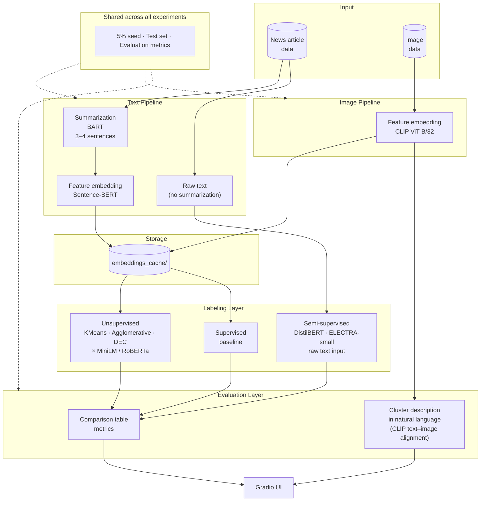

# Pipeline Architecture Overview

## Design Notes

| Decision | Rationale |
|---|---|
| Summarize with BART before embedding | Original articles (400–800 words) exceed the optimal context window of sentence embeddings; BART distills core information and reduces noise |
| Semi-supervised models receive raw text | Preserves full contextual signal without summarization filtering |
| CLIP chosen for image embedding | Its embedding space is jointly aligned with text — a prerequisite for automatic cluster description in natural language |
| `embeddings_cache/` | Vectors are computed once and reused across all experiments |
